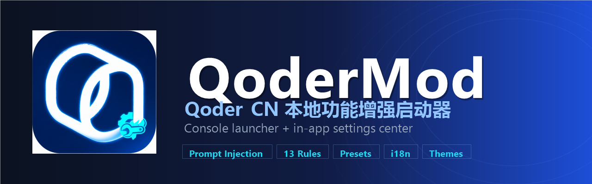
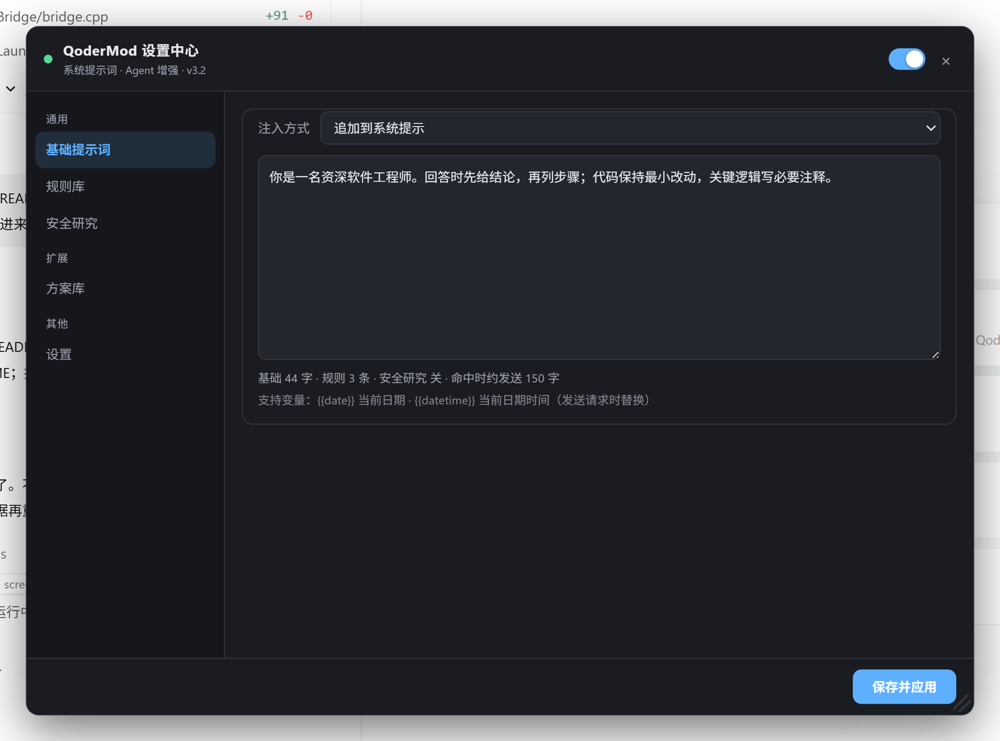

<p align="center">
  
</p>

<h1 align="center">QoderMod</h1>

<p align="center">
  <b>给 Qoder CN 桌面端做本地功能增强的极简启动器 + 内置设置中心</b><br/>
  <sub>A minimal console launcher + in-app settings center for the Qoder CN desktop app</sub>
</p>

<p align="center">
  
  
  
  
  
  
</p>

<p align="center">
  <a href="https://github.com/boxiaolanya2008/QoderMod/stargazers"></a>
  <a href="https://github.com/boxiaolanya2008/QoderMod/issues"></a>
  <a href="https://github.com/boxiaolanya2008/QoderMod/releases"></a>
</p>

> ⚠️ 本项目与 Qoder / 阿里巴巴官方无关，仅供本机个人学习与自用。
> Not affiliated with Qoder or Alibaba. For personal learning and local use only.

---

## 目录

- [✨ 特性](#-特性)
- [📸 界面预览](#-界面预览)
- [🚀 快速开始](#-快速开始)
- [🧩 架构与目录](#-架构与目录)
- [⚙️ 配置文件](#️-配置文件)
- [🌍 移植与自动定位](#-移植与自动定位)
- [🛠️ 构建](#️-构建)
- [⚠️ 已知限制](#️-已知限制)
- [📄 License](#-license)
- [English](#english)

---

## ✨ 特性

| | 功能 | 说明 |
|---|---|---|
| 🚀 | **一键启动并注入** | 控制台菜单 `[1]`：自动定位 Qoder、带调试端口启动、注入 `bridge.dll`；已运行则直接注入当前实例 |
| 🔁 | **自动重试** | 注入失败自动重试（单轮 5 次 + 整轮重试），`[2]` 关闭重启同样带重试 |
| 🌍 | **全盘扫描定位** | 相对路径 → 常见目录 → 注册表 → 全盘扫描（跳过系统目录、90 秒上限），结果缓存 |
| 💬 | **系统提示词注入** | 追加 / 前置 / 替换三种模式，支持 `{{date}}` / `{{datetime}}` 变量 |
| 📚 | **规则库** | 13 条内置 Agent 规则：中文优先、计划先行、批量编辑、补丁式写入、一次验证… |
| 🧪 | **安全研究模式** | 授权测试 / CTF / CVE 分析场景的提示框架 |
| 🗂️ | **方案库** | 把「提示词 + 规则 + 模式」保存为方案，一键切换，支持导入导出 |
| 🎨 | **主题与布局** | 跟随系统 / 深色 / 浅色；侧边栏 / 折叠 / 标签三种界面模式 |
| 🌐 | **中英双语** | 启动器与设置中心均支持中文 / English |
| 🔥 | **热更新** | 配置保存后约 2 秒热推送到所有页面，无需重启 |
| 📜 | **请求/注入日志** | 菜单 `[4]` 实时查看渲染层请求：`INJECTED/PASS`、注入字数、提示词样本 |
| 📦 | **零依赖分发** | 静态编译 DLL + 系统自带 csc，产物唯一命名，规避文件占用 |

## 📸 界面预览

<p align="center">
  
  <br/>
  <sub>Qoder 内置设置中心（深色主题）· In-app settings center (dark theme)</sub>
</p>

## 🚀 快速开始

```text
1️⃣ 双击 bin\QoderModLauncher.exe
2️⃣ 选择 [1] 启动并注入
3️⃣ 在 Qoder 顶部打开 QoderMod（或按 Ctrl+Shift+M）
4️⃣ 修改配置 → 保存并应用（约 2 秒热更新）
```

命令行：`--launch`（启动并注入）/ `--inject`（仅注入）/ `--find`（定位安装位置）/ `--reqlog`（打印请求日志）

## 🧩 架构与目录

```
QoderMod/
├─ src/
│  ├─ Launcher/Launcher.cs    控制台启动器（定位/启动/注入/日志/i18n）
│  ├─ Bridge/bridge.cpp       bridge.dll（CDP 注入、配置热更新、请求日志回传）
│  ├─ Payload/hook.js         渲染层功能层（提示词注入 + 请求记录）
│  ├─ Payload/ui.js           Qoder 内置设置中心（5 分区）
│  └─ Assets/qmod.ico|png     应用图标与母图
├─ assets/                    README 素材（banner / screenshot）
├─ build.bat                  一键构建
└─ bin/                       构建产物（不提交）
```

## ⚙️ 配置文件

保存在 `%USERPROFILE%\.qoder-cn\qcmod.json`：

```json
{
  "enabled": true,
  "mode": "append",
  "prompt": "你是一名资深软件工程师……",
  "rules": ["zh", "plan"],
  "secResearch": false,
  "theme": "auto",
  "lang": "auto"
}
```

## 🌍 移植与自动定位

- 启动器自动定位 Qoder：相对路径 → 常见安装目录 → 注册表卸载项 → 全盘扫描；
- 换电脑：复制整个 `QoderMod` 文件夹 → 菜单 `[3]` 扫描定位 → `[1]` 启动并注入；
- 构建产物使用唯一文件名（`bridge_<随机>.dll`），避免 DLL 被占用导致构建失败。

## 🛠️ 构建

| 依赖 | 说明 |
|---|---|
| x64 MinGW | 默认 `D:\Dev-Cpp\mingw64\bin\g++.exe`，可在 `build.bat` 修改 |
| .NET Framework 4.x | 系统自带 `csc.exe` |
| Node.js（可选） | 仅开发调试用 |

运行 `build.bat`，产物输出到 `bin\`。

## ⚠️ 已知限制

- 聊天与文件工具调用运行在 Qoder **主进程**，渲染层钩子只能覆盖渲染进程请求，部分聊天请求可能不经过提示词规则；
- Qoder 禁用 `--inspect` 并对 `app.asar` 有自愈机制，主进程级补丁不可行（相关尝试已移除）；
- 官方更新可能改变内部结构，导致注入失效。

## 📄 License

[MIT](LICENSE) · 图标基于 Qoder 标志魔改，仅作项目标识，商标归权利人所有。

<p align="center">
  <a href="https://star-history.com/#boxiaolanya2008/QoderMod&Date">
    
  </a>
</p>

---

<h1 id="english">English</h1>

<p align="center">
  
</p>

**QoderMod** is a lightweight local-enhancement toolkit for the Qoder CN desktop app:

- 🚀 **One-click launch & inject** — auto-discovers Qoder, starts it with a debug port, injects `bridge.dll`; injects into the running instance if already open
- 🔁 **Automatic retries** — 5 attempts per round plus one full retry
- 🌍 **Auto-discovery** — relative paths → common dirs → registry → full-drive scan (cached)
- 💬 **Prompt injection** — append / prepend / replace, with `{{date}}` / `{{datetime}}`
- 📚 **Rule library** — 13 built-in agent rules (plan-first, batch edits, patch-style writes, verify-once…)
- 🧪 **Security-research mode** — framing for authorized testing, CTF and CVE analysis
- 🗂️ **Presets** — save / apply / delete / export-import
- 🎨 **Themes & layouts** — system / dark / light; sidebar / accordion / tabs
- 🌐 **Bilingual** — Chinese / English everywhere
- 🔥 **Hot reload** — config saved to `%USERPROFILE%\.qoder-cn\qcmod.json`, applied in ~2s
- 📜 **Request/injection log** — menu `[4]` live view (`INJECTED/PASS`, injected chars, prompt sample)
- 📦 **Zero-dependency distribution** — static DLL + built-in `csc`

**Build:** run `build.bat` (x64 MinGW + .NET Framework). **Usage:** run `bin\QoderModLauncher.exe`, choose `[1]`, open **QoderMod** in Qoder, save settings.

**Known limitations:** chat/tool traffic lives in Qoder's main process (renderer hooks have partial coverage); `--inspect` is disabled and `app.asar` self-heals, so main-process patching is not viable; app updates may break injection.

**Disclaimer:** personal local use only; not affiliated with Qoder or Alibaba; the icon is a derivative of the Qoder logo for identification only.

---

<p align="center">
  <sub>Made with ❤️ by <a href="https://github.com/boxiaolanya2008">boxiaolanya2008</a> · 如果这个项目帮到你，欢迎点一个 ⭐</sub>
</p>
